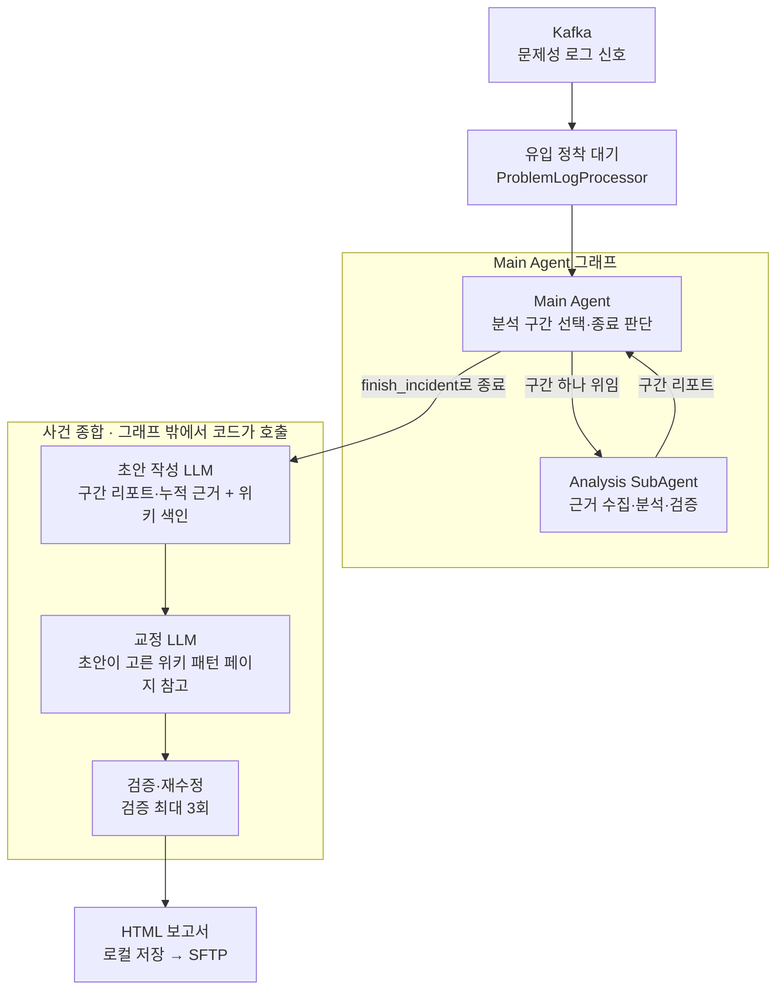

# ClusterDoctor

Elasticsearch 클러스터의 장애 신호를 받아 원인을 진단하고, 사건마다 HTML 보고서 한 장을 만드는 서비스입니다.

- Kafka 토픽(`KAFKA_TOPIC`)에서 slowlog·master log 오류 같은 문제성 로그 신호를 받습니다.
- 신호 유입이 멎으면 그 구간을 사건(Incident) 하나로 묶습니다.
- ClickHouse·Elasticsearch·SSH에서 근거를 모아 LLM 에이전트가 분석합니다.
- 결과는 `REPORT_DIR`에 HTML로 저장하고, 설정하면 SFTP로도 올립니다.

HTTP 서비스가 아니라 계속 실행되는 Kafka consumer입니다. 분석을 요청하는 API는 없습니다.

## 목차

1. [빠른 시작](#빠른-시작)
2. [동작 흐름](#동작-흐름)
3. [분석 방식](#분석-방식)
4. [보고서](#보고서)
5. [설정](#설정)
6. [고정 한도](#고정-한도)
7. [LLM 호출과 개인정보 보호](#llm-호출과-개인정보-보호)
8. [보조 스크립트](#보조-스크립트)
9. [로컬 통합 실행 (Docker Compose)](#로컬-통합-실행-docker-compose)
10. [코드 구조](#코드-구조)
11. [배포 메모](#배포-메모)
12. [알려진 한계](#알려진-한계)
13. [테스트](#테스트)

## 빠른 시작

### 요구 사항

- Python 3.13 이상, [uv](https://docs.astral.sh/uv/)
- 문제성 로그를 `KAFKA_TOPIC`으로 보내는 Kafka
- slowlog·query log·node metric·node log 테이블이 있는 ClickHouse
- cluster health·노드 정보 조회용 Elasticsearch
- Gemini 또는 NVIDIA NIM API key 하나
- 선택: data node 로그를 읽을 SSH 계정, 장애 패턴 위키(monitoring-wiki MCP 서버)

### 설치와 실행

```bash
cp .env.example .env      # 실제 값을 채운다. .env는 커밋하지 않는다.
uv sync
uv run python -m cluster_doctor.main
```

- 로그는 stderr와 `CLUSTER_DOCTOR_LOG_DIR/app.log`(기본 `logs/app.log`)에 남습니다.
- 보고서는 `REPORT_DIR`(기본 `reports/`)에 `report-*.html`로 저장됩니다.
- 필수 설정이 빠지면 첫 신호를 기다리지 않고 기동 단계에서 실패합니다. 오류 메시지에 secret 값은 나오지 않습니다.

## 동작 흐름



1. **신호 수신**: Kafka 메시지에서 발생 시각을 읽어 `ProblemLogSignal`을 만듭니다. 로그 종류는 거르지 않습니다. 발생 시각이 수신 시각보다 30분 넘게 앞서거나 미래이면 수신 시각을 대신 씁니다.
2. **유입 정착 대기**: 30초마다 새 신호가 있는지 보고, 연속 두 번 없으면 사건을 엽니다. 누적 대기는 최대 5분입니다.
3. **구간 분석**: Main Agent가 분석할 시간 구간을 고르고 Analysis SubAgent에 하나씩 맡깁니다. 결과를 보고 더 볼 구간이 있는지 판단하거나 종료합니다.
4. **사건 종합**: Main Agent 그래프가 끝나면 코드가 구간 리포트와 누적 근거로 사건 전체 리포트를 합성·검증합니다. Main Agent의 도구가 아니라 별도 LLM 호출이며, 위키가 연결돼 있으면 이 단계에서만 장애 패턴을 참고합니다.
5. **보고서 발행**: HTML을 로컬에 먼저 저장하고, 설정돼 있으면 SFTP로 올립니다.

정착 대기와 분석은 하나의 루프입니다. 한 사건의 분석이 끝나야 다음 신호의 정착 판단을 시작하고, 그 사이 들어온 신호는 큐에 쌓입니다. 진행 중인 사건에 새 신호를 합치거나 끝난 사건을 다시 실행하지 않습니다.

분석에 쓰는 원본 로그와 지표는 외부 수집기가 ClickHouse에 적재해 두어야 합니다. Kafka 신호는 사건을 여는 계기로만 씁니다.

## 분석 방식

### Main Agent: 어느 구간을 볼지 정한다

Main Agent는 원본 로그를 보지 않습니다. 시작 메시지로 트리거 시각과 최초·마지막 관측 시각(KST)을 받고, 다음 네 도구로 일합니다.

| 도구 | 역할 |
|---|---|
| `list_candidate_windows` | 아직 분석하지 않은 후보 구간과 남은 예산을 보여 준다 |
| `propose_analysis` | 구간을 검증·승인한다. 이미 본 부분은 잘라 내고, 예산을 넘으면 줄인다 |
| `task` | 승인된 구간 하나를 Analysis SubAgent에 맡긴다 |
| `finish_incident` | `COMPLETED` / `FAILED` / `CANCELLED`로 사건을 닫는다 |

- **첫 구간**: 최초 관측 분의 5분 전부터 그 분의 끝까지입니다. 예를 들어 최초 14:00:37이면 마지막 관측이 언제든 13:55~14:01입니다. 원인은 증상보다 앞에 있으므로 발생 이후는 첫 구간에 넣지 않고, 유입이 이어진 뒤쪽을 볼지는 Main Agent가 판단합니다. 코드가 만드는 첫 후보와 프롬프트의 안내가 같은 구간입니다.
- **추가 구간**: 다른 시간대를 봐야 답할 수 있는 구체적인 질문이 있고 예산이 남았을 때만 분석합니다. 원인이 미확정이라는 이유만으로 범위를 넓히지 않습니다.
- **강제 규칙**: 구간 길이, 분 예산, 호출 수, 중복 분석은 프롬프트가 아니라 코드(guardrail)가 막습니다. 수치는 [고정 한도](#고정-한도)를 참고하세요.
- `COMPLETED`로 닫으려면 구간 리포트가 하나 이상 있어야 합니다.

### Analysis SubAgent: 구간 하나를 끝까지 처리한다

도구는 `collect_evidence`, `write_report`, `report_insufficient` 세 가지입니다.

1. **근거 수집**: 소스마다 원본 로그를 1분 단위로 나눠 LLM이 중요한 레코드를 고릅니다. 모델은 레코드 번호와 선택 이유만 돌려주고, 시각·노드·메시지는 코드가 원본에서 옮깁니다. 빈 분은 호출하지 않고, 실패한 분은 수집 누락(gap)으로 남깁니다.
2. **소스 간 분석**: 모든 소스의 근거가 모인 뒤 원인 후보를 다루고 구간 리포트를 씁니다.
3. **검증**:
   - 구조 검사(`validate_report`): 근거·후보 참조와 원인·조치 연결을 확인합니다.
   - 원문 대조(`GroundingValidator`): 주장(claim)을 수집된 근거·관측값과 대조합니다.
   - 표현 불일치는 리포트를 고치고, 분석 불일치는 같은 구간을 다시 분석합니다. 검증은 최대 3회이고, 그 사이 수정과 재분석은 합쳐서 최대 2회(재분석은 1회)입니다.
   - 그래도 남으면 `MISMATCH`, 대조하지 못했으면 `NOT_VERIFIED`, 아니면 `PASSED`입니다. `PASSED`는 사실이 입증됐다는 뜻이 아니라 명확한 모순을 찾지 못했다는 뜻입니다.

소스별 처리는 다음과 같습니다.

- **slowlog·query log**: 위의 1분 단위 LLM 선별을 거칩니다.
- **노드 지표**: LLM을 쓰지 않습니다. heap·queue·rejected가 임계값을 넘은 최고점을 코드가 근거로 만듭니다.
- **master node 로그**: 매 구간 ClickHouse에서 읽습니다.
- **data node 로그**: master 로그에 노드 ID가 나올 때만 `NodeResolver`로 주소를 찾아 SSH로 읽습니다.

### 사건 종합과 장애 패턴 위키

구간 리포트가 하나 이상 있고 취소되지 않았으면, 코드가 누적 근거로 사건 전체 리포트를 합성하고 검증합니다. 합성에 실패해도 마지막 구간 리포트로 대신하지 않습니다.

`MONITORING_WIKI_URL`이 설정돼 있으면 장애 패턴 위키(MCP)를 참고합니다.

1. `get_index`로 패턴 색인을 읽어 종합 프롬프트에 넣습니다.
2. 모델이 권장 조치의 `wiki_ref`에 일치하는 패턴 id를 적습니다.
3. 코드가 그 패턴 페이지(증상·원인·해결방법, 최대 3개)를 `get_pattern`으로 열어 교정 단계에 넣습니다.
4. 최종 `wiki_ref`는 색인에 있는 id만 남깁니다. 보고서의 권장 조치 옆에 위키 배지로 표시됩니다.

우리 관측 데이터는 위키로 보내지 않습니다. 색인 조회가 실패하거나 색인에서 패턴 id를 읽지 못하면 경고를 남기고 위키 없이 종합합니다. 패턴 페이지가 열리지 않으면 나머지는 열지 않고 그때까지 연 페이지만 씁니다.

### 상태와 데이터 소유

- 에이전트 사이에는 요청·응답과 요약만 오갑니다. 근거·원문·리포트는 각 에이전트의 State가 소유하고, State 객체는 공유하지 않습니다. 그래서 Main Agent의 context가 원본 로그로 불어나지 않습니다.
- 구간 리포트는 `MainAgentState.window_results`에 그대로 쌓이고, 별도 저장소를 거치지 않습니다.

## 보고서

사건 하나당 `REPORT_DIR` 아래 HTML 파일 하나를 씁니다. 제목은 "Elasticsearch 쿼리·노드 로그 분석"입니다.

| 순서 | 섹션 | 내용 |
|---|---|---|
| 1 | 개요 | 발생·인지 일시, 복구 완료 일시, 총 장애 시간, 보고서 생성 시각 |
| 2 | 현상 및 원인 | 코드가 판정한 지연 범위·노드 응답 지연·클러스터 이벤트, 요약, 직접적·근본적 원인 |
| 3 | 권장 조치 | 조치 목록, 위키 패턴과 일치하면 위키 배지 |
| 4 | 쿼리 실행 추이 | 요청 기록 수와 분별 최대 실행시간 SVG 차트 |
| 5 | 주요 타임라인 | 사건 흐름 카드와 인용 원문 |
| 6 | 수집 데이터 보기 (접힘) | 느린 쿼리 순위, slowlog·마스터 노드 로그 원문, SSH 노드 로그, 시스템 지표 |

- **값의 출처를 나눕니다.** 건수·최대값 같은 숫자와 쿼리 후보는 코드가 센 `observations`에서 읽고, 모델이 옮겨 적지 않습니다. 모델은 해석(`narrative`)만 쓰고, 그 주장에는 근거 참조가 붙습니다.
- **표시 상한**: 마스터 로그 120건, slowlog·SSH 로그 각 10건입니다.
- **수집 상태를 구분합니다.** 조회 실패는 0건으로 그리지 않고 안내 문구로 표시합니다. 정상 조회 0건과 미수집도 구분하며, 마스터 로그·slowlog는 평소 0건이 정상입니다.
- **해석 주의**: `rejected`는 누적값이라 이번 구간의 실패나 회복으로 해석하지 않습니다. 조회 시점의 cluster health는 과거 사고 상태로 싣지 않습니다.
- **검증 결과에 따라 AI 해석의 표시가 달라집니다.** `MISMATCH`이거나 해석을 만들지 못했으면 AI 해석을 빼고 관측값만 보여 줍니다. `NOT_VERIFIED`이거나 일부 단계가 실패했으면 해석과 함께 주의 문구를 붙입니다. 검증 상태 값과 근거 ID 자체는 본문에 나오지 않고 로그에 남습니다.
- 인쇄하면 접힌 영역이 펼쳐집니다. 외부 웹폰트·CDN은 쓰지 않습니다.
- HTML 파일을 쓸 수 없으면 개인정보를 지운 평문을 로그로 남깁니다.

보고서에는 쿼리 조건과 회사·사용자 식별자가 담길 수 있습니다. `reports/`는 Git에 넣지 않습니다.

## 설정

설정은 환경 변수 또는 프로젝트 루트의 `.env`에서 읽습니다([settings.py](src/cluster_doctor/bootstrap/settings.py)). 템플릿은 [.env.example](.env.example)입니다.

### LLM

| 변수 | 기본값 | 설명 |
|---|---|---|
| `LLM_PROVIDER` | `nvidia_nim` | `gemini` 또는 `nvidia_nim` |
| `GEMINI_API_KEY` / `NVIDIA_API_KEY` | — | 선택한 provider의 key는 필수 |
| `GEMINI_MODEL` | `gemini-3.5-flash-lite` | |
| `NVIDIA_MODEL` | `google/gemma-4-31b-it` | litellm 로컬 비용표에 없어 비용이 0으로 기록될 수 있음 |
| `ANALYSIS_CONCURRENCY` | `15` | 분 단위 선별에서 동시에 처리하는 분의 수. 낮추면 메모리 피크가 줄고 분석이 느려질 수 있음 |
| `LITELLM_LOCAL_MODEL_COST_MAP` | `True` | litellm이 GitHub에서 비용표를 받지 않게 함(코드가 기본으로 설정) |

### 데이터 소스

| 변수 | 기본값 | 설명 |
|---|---|---|
| `CLICKHOUSE_URL` | — (필수) | 예: `jdbc:clickhouse://host:8123/packetbeat`. 이 database에 아래 네 테이블이 있어야 함 |
| `CLICKHOUSE_USER` / `CLICKHOUSE_PASSWORD` | `default` / 빈 값 | |
| `CLICKHOUSE_SLOWLOG_TABLE` / `CLICKHOUSE_LOG_TABLE` | `slowlog_v2` / `log` | slowlog, query log |
| `CLICKHOUSE_NODE_METRIC_TABLE` / `CLICKHOUSE_NODE_LOG_TABLE` | `es_node_metric` / `loki_logs` | 노드 지표, master node 로그 |
| `ES_HOST` / `ES_PORT` | — (필수) / `9200` | host는 쉼표로 여러 개 가능 |
| `ES_USER` / `ES_PASSWORD` | 빈 값 | 비면 basic auth를 쓰지 않음 |
| `SSH_USER` / `SSH_PASSWORD` / `SSH_PORT` | 빈 값 / 빈 값 / `22` | data node 로그용 |
| `CLUSTER_NAME` | `elasticsearch` | 보고서·로그에 표시할 이름. 빈 값 불가 |
| `NODE_HEAP_WARN_PERCENT` / `NODE_QUEUE_WARN` | `85` / `100` | 노드 지표 근거 임계값. 수집·작성·검증에 같은 값을 씀 |
| `MONITORING_WIKI_URL` | 빈 값 | 장애 패턴 위키 MCP 주소. 비면 위키 연동을 끔 |

### Kafka

| 변수 | 기본값 | 설명 |
|---|---|---|
| `KAFKA_BOOTSTRAP_SERVERS` | `localhost:9092` | |
| `KAFKA_TOPIC` | `slowlog` | |
| `KAFKA_GROUP_ID` | `clusterdoctor` | |
| `KAFKA_FAILURE_TIMEOUT_SECONDS` | `300` | 연결 확인 실패가 이 시간 동안 이어지면 종료. 양수만 허용 |

### 보고서·로그

| 변수 | 기본값 | 설명 |
|---|---|---|
| `REPORT_DIR` | `reports` | 보고서 저장 디렉터리. 상대 경로는 작업 디렉터리 기준 |
| `REPORT_SFTP_HOST` | 빈 값 | 비면 SFTP 업로드를 끔 |
| `REPORT_SFTP_PORT` / `REPORT_SFTP_TIMEOUT_SECONDS` | `22` / `10` | |
| `REPORT_SFTP_USER` / `REPORT_SFTP_REMOTE_DIR` | — | SFTP를 켜면 필수 |
| `REPORT_SFTP_PASSWORD` / `REPORT_SFTP_KEY_FILE` | — | SFTP를 켜면 둘 중 하나는 필수 |
| `REPORT_SFTP_KNOWN_HOSTS` | 빈 값 | 비면 호스트 키를 검증하지 않음. 운영에서는 지정 권장 |
| `CLUSTER_DOCTOR_LOG_DIR` | `logs` | `app.log` 디렉터리. Kafka 등이 쓰는 `LOG_DIR`과 겹치지 않게 앱 전용 이름을 씀 |
| `LOG_MAX_BYTES` / `LOG_BACKUP_COUNT` | `10485760` / `5` | `app.log` 크기 기준 로테이션. 총량은 약 `(BACKUP_COUNT + 1) × MAX_BYTES` |

`REPORT_DIR`, `CLUSTER_DOCTOR_LOG_DIR`, `LOG_MAX_BYTES`, `LOG_BACKUP_COUNT`, `ANALYSIS_CONCURRENCY`, `REPORT_SFTP_PORT`, `REPORT_SFTP_TIMEOUT_SECONDS`는 빈 값이면 기본값을 씁니다. 그 밖의 숫자 설정에 빈 값을 넣으면 기동이 실패하므로 줄을 지우거나 값을 넣습니다. 디렉터리가 없으면 자동으로 만들고, 실행 계정에 쓰기 권한이 있어야 합니다.

### SFTP 업로드 동작

- 보고서는 항상 `REPORT_DIR`에 먼저 저장하고, 저장에 성공한 파일만 올립니다. 로컬 파일은 자동으로 지우지 않습니다.
- 임시 이름(`.part`)으로 올린 뒤 이름을 바꾸므로 받는 쪽이 쓰다 만 파일을 보지 않습니다. 같은 이름이 있으면 `-2`, `-3`을 붙여 덮어쓰지 않습니다. 원격 디렉터리가 없으면 만듭니다.
- 네트워크 오류는 한 번 더 시도하고, 그래도 실패하면 로그만 남깁니다. 인증 실패·호스트 키 불일치·권한 오류는 다시 시도하지 않습니다.
- 업로드는 사건 처리 흐름 안에서 기다립니다. 서버에 접속할 수 없으면 그 사건의 게시가 약 20초 늦어질 수 있습니다.
- 접속 정보를 바꾼 뒤에는 `uv run python scripts/upload_report_sftp.py`로 최근 보고서 한 건을 올려 확인합니다.

### Kafka 연결 감시

- offset은 `(group, topic, partition)` 기준입니다. committed offset이 없으면 `auto_offset_reset=latest`로 끝에서 시작하므로, 처음 기동하기 전에 보낸 메시지는 읽지 않습니다.
- 10초마다 연결을 확인합니다. 확인 대상은 topic 존재, 할당된 partition leader의 `end_offsets()`, group coordinator의 `committed()`입니다. 메시지를 소비하거나 offset을 바꾸지 않습니다.
- 확인 실패가 `KAFKA_FAILURE_TIMEOUT_SECONDS` 동안 이어지면 이유를 로그에 남기고 **종료 코드 1로 프로세스를 끝냅니다**. 이때 대기·진행 중인 분석은 폐기합니다. 연결이 복구되면 실패 누적 시간을 초기화합니다.
- 자동 재시작은 앱이 아니라 실행 관리자(systemd 등)에서 설정합니다.

## 고정 한도

환경 변수가 아니라 코드 상수입니다.

| 한도 | 값 | 위치 |
|---|---:|---|
| 분석 구간 길이 | 최대 10분 | `incident_analysis_agent/model/time_range.py` |
| 사건당 분석 예산 | 60분, 12회 | `incident_orchestrator_agent/service/analysis_window/guardrails.py` |
| Main Agent 사이클 / 연속 거절 | 16회 / 3회 | 〃 |
| 사건 처리 시간 | 30분 | 〃 |
| 유입 정착 대기 | 30초 간격, 최대 300초 | `kafka_consumer/trigger_settling/service/problem_log_processor.py` |
| 대기 큐 | 10,000건 | `main.py` |
| 근거 수 | 소스당 25, 전체 80 | `incident_analysis_agent/service/evidence_collection/limits.py` |
| 프롬프트 원문 | 60,000자 | 〃 |
| SSH 조사 노드 | 2대 | `incident_analysis_agent/service/node_investigation/node_investigation.py` |
| 소스 조회 행 수 | 소스·분당 10,000 | `incident_analysis_agent/datasource/clickhouse/client.py` |
| ClickHouse node 로그 | 기본 300, 최대 2,000 | 〃 |
| SSH node 로그 | 기본 300줄 | `incident_analysis_agent/datasource/ssh/node_log.py` |
| SSH timeout | 접속 10초, 명령 30초 | 〃 |
| 보고서 마스터 로그 | 120건 | `incident_analysis_agent/service/observation/builder.py` |
| LLM 요청 timeout | 1,200초 | `incident_analysis_agent/agent/runtime/litellm_client.py` |
| ClickHouse / ES 요청 timeout | 30초 / 10초 | `main.py` |

## LLM 호출과 개인정보 보호

### 재시도와 rate limit

- 직접 호출은 `litellm_client.complete()`, 에이전트는 `ChatLiteLLM`을 씁니다. litellm 내부 재시도는 끄고, 애플리케이션이 429·503만 **최대 2회** 다시 시도합니다. 두 경로가 같은 대기 정책(`_retry_wait`)을 씁니다.
- 대기 시간은 숫자인 `Retry-After` 헤더를 먼저 보고, 없으면 오류 본문의 `retryDelay`를 읽어 1초를 더합니다.
- 제공된 대기가 60초를 넘거나, 대기 시간 없이 토큰 한도(`quotaId`에 Token) 429가 오면 다시 시도하지 않습니다. 그 밖의 429·503은 5초 뒤 다시 시도합니다.
- Gemini 직접 호출에만 최소 호출 간격 5초(분당 12회)를 둡니다. 에이전트 호출에는 적용되지 않습니다.
- 실패한 분은 gap으로 남기므로 그것만으로 사건 전체를 버리지 않습니다.
- 진단 로그에는 상태 코드, 짧은 오류 코드, 허용한 rate-limit 헤더만 남깁니다. 응답 본문·요청 URL·`str(exc)`는 기록하지 않습니다.

### 가명화

- LLM으로 가는 메시지와 도구 호출 값에서 IPv4·이메일·등록된 회사·사용자·요청 ID를 가명으로 바꾸고, 응답에서 원래 값으로 되돌립니다.
- 대응표는 사건마다 새로 만들고, 같은 사건의 Main·SubAgent와 분 단위 분석이 공유합니다. 분석이 끝나면 해제합니다.
- 키워드·노드 이름·쿼리 본문 자체는 가명으로 바꾸지 않습니다. 다만 그 안에 들어 있는 IP·이메일·등록 식별값에는 치환을 적용합니다.
- DeepAgent의 별도 `system_message`는 변환하지 않습니다. 저장된 원본 데이터는 바꾸지 않습니다.

## 보조 스크립트

| 스크립트 | 용도 | 외부 호출 |
|---|---|---|
| `scripts/run_analysis.py` | Kafka 없이 특정 시각으로 같은 분석 경로(`RunManualAnalysis`)를 한 번 실행 | 실제 ClickHouse·ES·SSH·LLM (`--dry-run`이면 없음) |
| `scripts/produce_test_message.py` | 테스트용 신호를 Kafka에 보냄 | Kafka |
| `scripts/preview_report.py` | 합성 데이터로 실제 보고서 렌더링·발행 경로 확인 | 없음 |
| `scripts/evaluate_report_prompts.py` | 보고서 프롬프트 평가. `offline`은 고정 응답으로 계약만 확인, `live`는 실제 모델 호출 | `live`만 LLM |
| `scripts/upload_report_sftp.py` | SFTP 접속·인증·쓰기 권한 확인 | SFTP 서버 |
| `scripts/generate_docker_mock.py` | 최근 시각의 격리된 ClickHouse fixture 파일 생성 | 없음 |

```bash
# 시각·범위만 계산하고 실행하지 않는다
uv run python scripts/run_analysis.py --at "2026-09-16T04:22:00" --span 6m --dry-run

# 실제 진단을 실행한다 (운영 데이터·LLM 호출)
uv run python scripts/run_analysis.py --at "2026-09-16T04:22:00" --span 6m

# 신호 3건을 보낸다
uv run python scripts/produce_test_message.py --at "2026-09-16T04:22:00" --count 3

# 보고서 미리보기 (variant: default, ssh, mismatch, not-verified, ssh-not-verified, master, all)
uv run python scripts/preview_report.py --variant ssh --output reports/example.html

# 프롬프트 평가
uv run python scripts/evaluate_report_prompts.py --mode offline --output reports/offline-evaluation.json
```

- `--at`은 ISO 8601이고, 오프셋이 없으면 KST로 읽습니다. `run_analysis.py`와 `produce_test_message.py`는 같은 인자(`--at`, `--count`, `--span`, `--dry-run`)를 씁니다.
- `run_analysis.py --dump-context`는 Main Agent가 받은 메시지를 JSON으로 남깁니다. 시스템 프롬프트와 도구 정의 원문이 들어가므로 저장소에 올리지 않습니다.
- `preview_report.py`는 HTML과 같은 이름의 평문도 함께 저장합니다.
- `evaluate_report_prompts.py --mode live`는 기본 120초 실행 예산이 있고 `--budget-seconds`로 바꿀 수 있습니다(Unix). offline 결과는 모델의 진단 정확도를 증명하지 않습니다.

## 로컬 통합 실행 (Docker Compose)

Kafka·ClickHouse·Elasticsearch는 Docker로 띄우고, ClusterDoctor는 로컬에서 실행합니다. **실제 LLM API를 호출합니다.**

1. `.env`에 LLM key와 다음 연결 설정을 넣습니다. 기존 `.env`가 운영 시스템을 가리키고 있다면 아래 값으로 모두 덮어써야 운영 데이터를 건드리지 않습니다.

   ```dotenv
   CLICKHOUSE_URL=jdbc:clickhouse://localhost:8123/packetbeat?compress=0
   CLICKHOUSE_USER=clusterdoctor
   CLICKHOUSE_PASSWORD=clusterdoctor
   ES_HOST=localhost
   ES_PORT=9200
   ES_USER=
   ES_PASSWORD=
   KAFKA_BOOTSTRAP_SERVERS=localhost:29092
   KAFKA_TOPIC=slowlog
   KAFKA_GROUP_ID=clusterdoctor
   ```

2. 인프라를 띄우고 ClusterDoctor를 실행합니다.

   ```bash
   docker compose up -d
   uv run python -m cluster_doctor.main
   ```

3. `Kafka consumer started`가 보이면 다른 터미널에서 신호를 보냅니다.

   ```bash
   uv run python scripts/produce_test_message.py --at "2026-01-15T10:00:00+09:00"
   ```

4. 정착 대기와 LLM 호출이 끝나면 `reports/report-*.html`이 생깁니다. 끝나면 `docker compose down`으로 내립니다.

참고:

- ClickHouse fixture는 [docker/clickhouse/init.sql](docker/clickhouse/init.sql)이 빈 볼륨을 처음 만들 때만 적재합니다. 처음 상태로 되돌리려면 `docker compose down -v`로 볼륨을 지우고 다시 띄웁니다.
- 신호 시각이 수신 시각보다 30분 넘게 오래되면 수신 시각으로 대체되어 fixture 데이터와 구간이 어긋날 수 있습니다. 근거 수집까지 확인하려면 fixture 데이터와 신호 시각을 최근의 같은 구간으로 맞춥니다.

## 코드 구조

폴더는 계층이 아니라 **누가 실행하는가 → 목적 → 구현 기술** 순서로 나뉩니다.

```text
src/cluster_doctor/
├── main.py                        # 조립(Composition Root): 실행 객체를 직접 만들어 주입
├── bootstrap/                     # 설정(settings.py), 공유 client 수명(resources.py)
├── kafka_consumer/                # Kafka 수신, 유입 정착 대기
├── incident_orchestrator_agent/   # Main Agent: 분석 범위·수명 관리, 보고서 발행
└── incident_analysis_agent/       # Analysis SubAgent: 근거 수집·분석·검증·사건 종합
```

- Orchestrator가 Analysis를 호출하고, Analysis는 Orchestrator에 의존하지 않습니다.
- 실행 State는 각 에이전트의 `agent/state.py`, 공유 데이터 계약은 소유자의 `model/`에 둡니다.
- `aiokafka` 의존성은 `kafka_consumer/consumer/kafka`에만 있습니다.
- 실행 객체·모델·seams는 기동 시 한 번 만듭니다. Main graph는 사건마다, Analysis graph와 State는 구간마다 새로 만듭니다.
- 정상 종료 시 분석을 정리한 뒤 공유 ClickHouse·Elasticsearch client를 닫습니다.

### 단계별 코드 위치

| 단계 | 시작 코드 |
|---|---|
| 프로세스 시작·조립 | [main.py](src/cluster_doctor/main.py) (`compose_analysis_service`, `build_runtime_resources`, `build_report_publisher`) |
| Kafka 수신 | [kafka_consumer/consumer/kafka/consumer.py](src/cluster_doctor/kafka_consumer/consumer/kafka/consumer.py) |
| 유입 정착·순차 분석 루프 | [kafka_consumer/trigger_settling/service/problem_log_processor.py](src/cluster_doctor/kafka_consumer/trigger_settling/service/problem_log_processor.py) |
| 사건 수명(timeout·발행) | [incident_orchestrator_agent/service/incident_lifecycle/analyze_incident.py](src/cluster_doctor/incident_orchestrator_agent/service/incident_lifecycle/analyze_incident.py) |
| Main Agent | [incident_orchestrator_agent/agent/adapter.py](src/cluster_doctor/incident_orchestrator_agent/agent/adapter.py) |
| 구간 후보·승인 규칙 | [incident_orchestrator_agent/service/analysis_window/](src/cluster_doctor/incident_orchestrator_agent/service/analysis_window/) |
| Analysis 위임 어댑터 | [incident_orchestrator_agent/agent/analysis_subagent.py](src/cluster_doctor/incident_orchestrator_agent/agent/analysis_subagent.py) |
| 근거 수집 | [incident_analysis_agent/service/evidence_collection/collector.py](src/cluster_doctor/incident_analysis_agent/service/evidence_collection/collector.py) |
| 검증 루프 | [incident_analysis_agent/agent/subagent.py](src/cluster_doctor/incident_analysis_agent/agent/subagent.py) |
| 구조 검사 / 원문 대조 | [service/validation/consistency/](src/cluster_doctor/incident_analysis_agent/service/validation/consistency/) / [service/validation/grounding/](src/cluster_doctor/incident_analysis_agent/service/validation/grounding/) |
| 사건 종합·위키 | [incident_analysis_agent/service/report_generation/incident_synthesis.py](src/cluster_doctor/incident_analysis_agent/service/report_generation/incident_synthesis.py) |
| 위키 MCP client | [incident_analysis_agent/datasource/mcp/wiki_client.py](src/cluster_doctor/incident_analysis_agent/datasource/mcp/wiki_client.py) |
| HTML 렌더링 | [incident_orchestrator_agent/service/report_delivery/rendering/html/](src/cluster_doctor/incident_orchestrator_agent/service/report_delivery/rendering/html/) |
| 파일·SFTP 발행 | [incident_orchestrator_agent/service/report_delivery/publication/](src/cluster_doctor/incident_orchestrator_agent/service/report_delivery/publication/) |

### ClickHouse 테이블

| 테이블 | 시각 컬럼 | 내용 |
|---|---|---|
| `slowlog_v2` | `_source.@timestamp` | 느린 쿼리의 index, node, took, hits, shards, query, opaque-id |
| `log` | `reg_date` | 쿼리 로그: 실행 시간·유형, 검색 기간, 키워드·사용자·회사, URL·건수 등 |
| `es_node_metric` | `reg_date` | CPU, OS memory, JVM heap, search/write queue와 rejected |
| `loki_logs` | `timestamp` | master node 로그: role, level, logger, filename, host |

- 시각은 KST로 읽습니다.
- `slowlog_v2`는 ClickHouse 적재 시각(`ch_ingested_at`)이 아니라 Elasticsearch 발생 시각으로 거릅니다. 적재 지연이 분 경계를 넘으면 신호를 만든 slowlog를 놓칠 수 있기 때문입니다.
- `os_mem`은 page cache를 포함합니다. Elasticsearch는 남는 RAM을 cache로 쓰므로 95~99%만으로는 메모리 압박이 아닙니다. JVM heap, GC 경고, `search_rejected`와 함께 판단합니다.
- 분마다 slowlog·query log·노드 지표를 병렬로 조회합니다. 소스별로 독립 처리하며, 실패한 소스는 수집 누락으로 남기고 성공한 결과는 유지합니다.

## 배포 메모

- **컨테이너 이미지**: [Dockerfile](Dockerfile)이 `python:3.13-slim`에 uv로 의존성을 설치하고 `python -m cluster_doctor.main`을 실행합니다.
- **tiktoken 캐시**: 처음 `import litellm`할 때 tiktoken encoding을 인터넷에서 받습니다. 네트워크가 막힌 환경에서는 기동이 실패할 수 있으니, 이미지 빌드 중에 `python -c "import litellm"`으로 캐시를 데웁니다(Dockerfile에 포함). `LITELLM_LOCAL_MODEL_COST_MAP`은 이 다운로드를 막지 못합니다.
- **litellm 경량화**: 이미지 크기를 줄일 때 `litellm/proxy/` 전체를 지우지 않습니다. 실제 `completion()` 경로가 씁니다.
- **위키 연동**: 서버 환경에 `mcp>=2.3.0`이 설치돼 있어야 합니다. 없으면 위키 조회가 실패하고, 경고를 남긴 뒤 위키 없이 종합합니다.
- **로그 위치**: 셸에 Kafka용 `LOG_DIR`이 있어도 앱은 `CLUSTER_DOCTOR_LOG_DIR`만 읽습니다.
- **Windows**: 편집기가 `app.log`를 열어 두면 로테이션 시 이름 변경이 실패할 수 있습니다. 로그 기록 오류는 콘솔에만 남고 분석은 계속됩니다.

## 알려진 한계

- 무료 tier의 토큰 한도에는 여전히 닿을 수 있습니다. 재시도를 줄여도 프롬프트 자체가 크면 바쁜 구간에서 한도를 넘습니다.
- 모델의 해석(`narrative`)이 실행마다 비어 있을 수 있습니다. 그래도 관측값과 수집 누락은 보고서에 전달됩니다.
- 대기 큐는 메모리 기반입니다. 프로세스가 끝나면 대기 중인 신호를 복구하지 않고, 실패한 사건을 자동으로 다시 실행하지 않습니다. 큐가 가득 차면 새 신호를 버립니다.
- 마스터 로그 0건과 아직 적재되지 않음을 구별하지 못합니다. 마스터 로그는 ClickHouse에서만 읽고, SSH로 대신 읽지 않습니다.
- data node 로그는 SSH 계정과 네트워크 도달성에 의존합니다. Elasticsearch가 내부 주소를 돌려주면 외부 실행 host의 SSH는 timeout 뒤 수집 누락으로 남습니다.

## 테스트

```bash
uv run pytest
uv run python -m compileall -q src
uv run python scripts/run_analysis.py --at 2026-09-16T04:22:00 --span 6m --dry-run
```

- `tests/unit`: 각 에이전트의 model·datasource·service·agent를 외부 의존 없이 검사합니다.
- `tests/integration/test_html_publication.py`: 리포트 projection부터 HTML 렌더링·파일 저장까지 이어서 검사합니다.
- 실제 외부 시스템과 보고서 생성은 [로컬 통합 실행](#로컬-통합-실행-docker-compose)으로 확인합니다.
